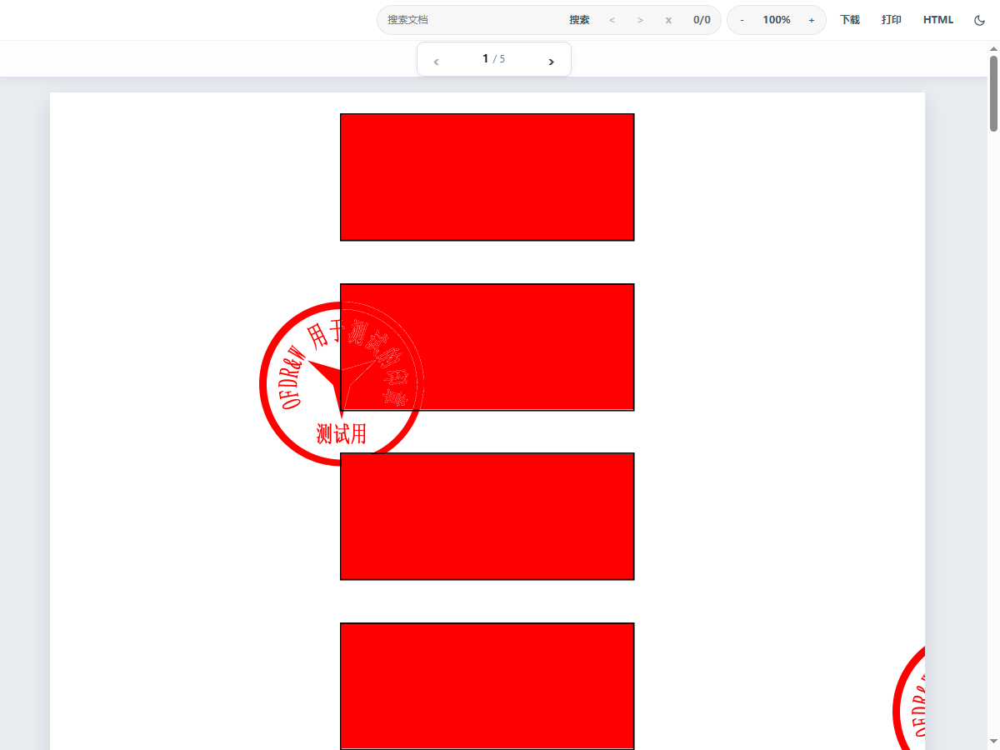
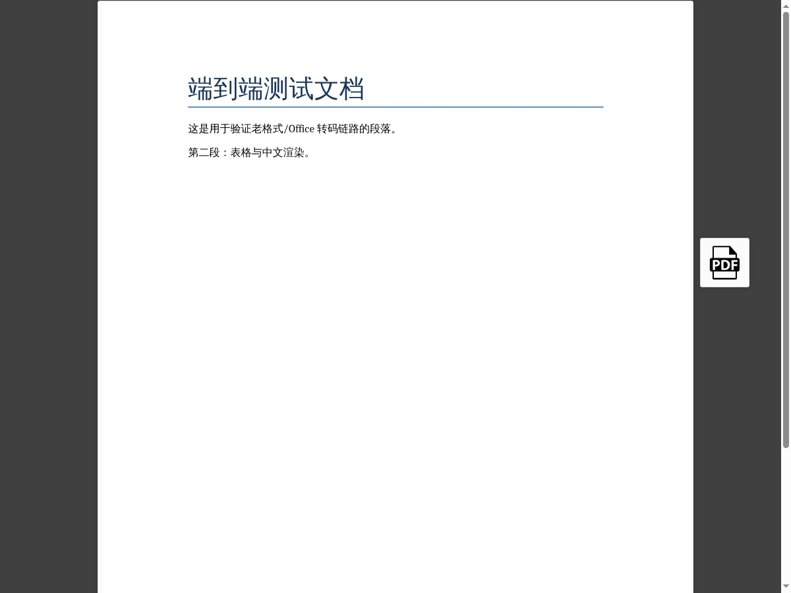

# DocLens · 内网离线文档预览平台

> 可完全离线部署的文档预览与转换服务：**OFD、Office、PDF 在线预览**，
> **PDF ⇄ Word 互转**，**扫描件 OCR**。面向内网环境设计，不依赖外部 CDN。

[](LICENSE)

---

## 能力

| 能力 | 实现方式 |
|---|---|
| PDF / 图片 / 音视频预览 | 浏览器原生渲染，不经服务端 |
| OFD 预览 | 纯前端渲染（[flyfish file-viewer](https://github.com/flyfish-dev/file-viewer)），无后端转码，支持签章图层 |
| Word / Excel / PPT 预览 | kkFileView + LibreOffice 转码 |
| 老格式 `.doc` / `.xls` / `.ppt` 预览 | 同上 |
| PDF → Word | pdf2docx，独立子进程 + 硬超时 |
| Word / PPT → PDF | 复用 LibreOffice 转码产物 |
| 扫描件 → 可搜索 PDF | 保留原页面，叠加不可见文字层 |
| 扫描件 → 文字 Word | RapidOCR（PP-OCRv4），输出纯文本 |

未包含的能力见[限制](#限制)。

## 界面

| OFD 预览（含签章） | Word 预览 |
|---|---|
|  |  |

## 背景

内网文档场景中的三类常见问题：

1. **OFD 兼容性** —— 国产版式文档，多数 PDF 工具无法打开，常见预览组件亦不支持
2. **外网资源依赖** —— 部分预览方案从 CDN 加载 pdf.js、字体与 worker，断网后不可用
3. **临时文件残留** —— 上传文件在服务器上长期堆积，缺少清理机制

本项目对应三项设计：OFD 由前端渲染器解析、全部静态资源随包分发、
临时文件写入内存盘并在会话结束时清理。

## 架构

```
                      ┌──────────────────────────────────────┐
  浏览器  ──────────► │  nginx  (对外唯一端口)                │
                      │  /        -> 静态前端 + OFD 渲染器    │
                      │  /api/    -> portal:8000              │
                      │  /preview -> kkfileview:8012          │
                      └───────┬───────────────┬──────────────┘
                              │               │
                     ┌────────▼──────┐  ┌─────▼──────────┐
                     │ portal        │  │ kkFileView     │
                     │ 上传 / 路由   │  │ LibreOffice    │
                     │ 转换 / OCR    │  │ 老格式转码     │
                     │ /data = tmpfs │  │ /tmp = tmpfs   │
                     └───────────────┘  └────────────────┘

  OFD 不经服务端：浏览器加载 fv-ofd.js 后本地解析渲染。
```

三个容器，单张 bridge 网络，仅 nginx 暴露端口。

## 快速开始

部署分两步：先在可联网的机器上生成离线包，再将离线包导入内网环境安装。

```
 ┌──────────── 构建机（可联网）──────────────┐      ┌───────── 内网目标机（离线）─────────┐
 │ 1. clone 仓库                            │      │ 3. 校验 + 解压                       │
 │ 2. ./build/build-bundle.sh               │ ───► │ 4. deploy/install.sh                 │
 │    → dist/doclens-1.0.0-x86_64.tar.gz    │ 传输 │    → http://<内网IP>:8080            │
 └──────────────────────────────────────────┘      └──────────────────────────────────────┘
```

若目标机可访问外网，或内网已部署镜像仓库（Harbor 等），两步可在同一台机器完成。

### 第 1 步：在构建机上生成离线包

**构建机要求**：x86_64 Linux、Docker、可访问镜像仓库（Docker Hub 或内网 Harbor）、
可访问 PyPI（构建 portal 镜像时需安装依赖）、磁盘 ≥ 10 GB。

```bash
git clone https://github.com/MiyauchiRenge/doclens.git
cd doclens
./build/build-bundle.sh
# 产物：dist/doclens-1.0.0-x86_64.tar.gz（约 1.1 GB）
```

构建脚本依次拉取镜像、构建 portal、执行健康检查，任一步失败即中止，
不生成不可安装的包。

常用参数：

```bash
# 镜像已存在于本地（例如刚从内网仓库拉取），跳过拉取与构建
./build/build-bundle.sh --no-pull

# 一并打包 Docker 的 RPM（目标机未配置 dnf 源时使用）
./build/build-bundle.sh --with-rpms
```

若构建机仅能访问内网仓库，修改 `versions.env` 中的镜像地址；pip 可指定国内源：

```bash
docker build --build-arg PIP_INDEX_URL=https://pypi.tuna.tsinghua.edu.cn/simple \
  -t fileview/portal:1.0.0 services/portal
```

### 第 2 步：导入内网安装

**目标机要求**：x86_64、Docker 20.10+、Compose v2、内存 ≥ 8 GB（推荐）、
磁盘 ≥ 10 GB。

内存低于 8 GB 时，kkFileView 的 JVM 与 LibreOffice 可能无法完成初始化，
表现为预览返回 502；此时需调小 `KK_JAVA_OPTS`，详见[限制](#限制)与
[docs/DEPLOY.md](docs/DEPLOY.md#排障)。

传输方式不限（U 盘、WinSCP、`scp`），需同时携带 `.tar.gz` 与 `.sha256`。

```bash
sha256sum -c doclens-1.0.0-x86_64.tar.gz.sha256
tar -xzf doclens-1.0.0-x86_64.tar.gz
cd doclens-1.0.0-x86_64

sudo bash deploy/preflight.sh          # 可选，只读环境检查
sudo bash deploy/install.sh --port 8080
```

安装完成后访问 `http://<内网IP>:8080`。

目标机未安装 Docker 时，参见 [docs/DEPLOY.md](docs/DEPLOY.md#无-docker-的机器)。

## 配置

修改 `/opt/fileview/.env` 后执行 `docker compose up -d` 生效。

| 参数 | 默认 | 说明 |
|---|---|---|
| `HTTP_PORT` | 8080 | 对外端口 |
| `SESSION_TTL` | 1800 | 会话存活秒数，同时作为下载链接有效期 |
| `MAX_UPLOAD_MB` | 200 | 单文件上限 |
| `CONVERT_TIMEOUT` | 300 | PDF→Word 硬超时 |
| `CONVERT_CONCURRENCY` | 1 | 转换并发数，CPU 密集，建议 1~2 |
| `TMPFS_SIZE` | 2g | portal 内存盘上限 |
| `KK_JAVA_OPTS` | `-Xmx768m` | kkFileView 堆大小；内存 ≤ 4 GB 时须限制 |
| `OCR_TIMEOUT` | 1800 | OCR 任务超时 |
| `OCR_CONCURRENCY` | 1 | OCR 并发数，内存 ≤ 4 GB 时保持 1 |

部署细节、端口修改、升级与卸载见 [docs/DEPLOY.md](docs/DEPLOY.md)。

## 临时文件处理

四层机制：

1. **存储层**：portal 的 `/data`、kkFileView 的 `/tmp` 与转码目录均挂载 **tmpfs**
2. **会话层**：每次上传分配独立目录，存储文件名随机化，原始文件名仅存于内存索引
3. **触发层**：页面关闭时通过 `sendBeacon` 通知服务端清理
4. **兜底层**：`SESSION_TTL` 到期批量清理，每 30 秒扫描无索引的孤儿目录

清理发生在会话结束或 TTL 到期时，容器停止后内存盘内容随之释放。
该机制不提供加密擦除，也不保证介质层面的不可恢复。

## 限制

**1. Office 预览由 LibreOffice 渲染，与 Word 存在版式差异。**
文本框、图文环绕、表格边框、分页位置等差异无法通过补充字体消除。
版式一致性要求高时，应在源端另存为 PDF 后上传。

字体替换的影响最大：项目内置 Carlito（对应 Calibri）、Caladea（对应 Cambria）
及一组 fontconfig 映射；「等线」映射至黑体而非微软雅黑，因后者行高显著偏大，
会导致整页行距被撑开。详见 [fonts/README.md](fonts/README.md)。

**2. OCR 不重建版式。**
可搜索 PDF 保留原始外观，仅提供检索与复制；文字 Word 可编辑，
但表格按行散开、图片与底色不保留。

**3. 不支持 Excel → PDF。**
kkFileView 的 Excel 预览采用 HTML 表格渲染，不生成 PDF。

**4. 不提供 Office 在线编辑。**
本项目范围为预览与格式转换。

## 文档

| 文件 | 内容 |
|---|---|
| [docs/DEPLOY.md](docs/DEPLOY.md) | 部署细节、端口、升级卸载、排障 |
| [docs/VERIFY.md](docs/VERIFY.md) | 验证记录：实测项、未验证项、已修复问题 |
| [THIRD_PARTY.md](THIRD_PARTY.md) | 依赖许可清单与发布检查项 |
| [fonts/README.md](fonts/README.md) | 字体替换规则与实测数据 |

## 许可证

本项目采用 **AGPL-3.0**，全文见 [LICENSE](LICENSE)。

核心功能依赖 **PyMuPDF**（AGPL-3.0 或 Artifex 商业授权）：`pdf2docx` 依赖它，
扫描件检测与 OCR 亦直接调用。因此本项目的整体分发适用 AGPL-3.0。

- 可自由使用、修改、分发，含商业用途
- 分发时须提供完整对应源码，并保留同一许可证
- 依第 13 条，通过网络提供服务时须向使用者提供源码获取方式

内网自用且不对外分发时，保持源码仓库可访问通常即可满足第 13 条。
如需闭源商用，须取得 PyMuPDF 商业授权或替换该依赖。

**源码地址**：https://github.com/MiyauchiRenge/doclens

第三方组件许可见 [THIRD_PARTY.md](THIRD_PARTY.md)。
